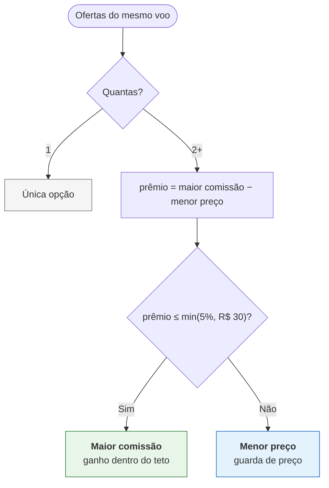

# PassHub — Agregador de Provedores de Voos

Consulta três provedores em paralelo, normaliza, deduplica e decide qual
oferta mostrar — maximizando margem sem prejudicar o cliente.

**Produção:** https://passhub.abel.dev.br
`docker compose up -d` · `npm test` (65 testes)

## Requisitos → onde estão

Cada linha tem a prova: um link que abre em produção, um comando que roda, ou
o arquivo que implementa.

### Funcionais

| Requisito | Prova |
|---|---|
| `POST /search` | [Swagger](https://passhub.abel.dev.br/docs) · `src/http/search/` |
| Consultas paralelas aos 3 providers | `src/adapters/http/providers/fan-out.ts` — `Promise.allSettled` |
| Timeout de 3 s por provider | `client.ts:8` — `TIMEOUT_MS = 3_000` |
| Continua se um provider falhar | `docker compose --profile chaos up` derruba o provider-c · `tests/resilience.test.ts` (4 casos: 500, timeout, erro, lento) |
| Cache Redis TTL 5 min | [tela de telemetria](https://passhub.abel.dev.br/telemetria) mostra o TTL de cada entrada descendo · `tests/resilience.test.ts` assere 300 s |
| Normalização em modelo único | `src/core/search/adapters/index.ts` (centavos→real, ISO→UTC, descarta USD e preço≤0) · `tests/adapters.test.ts` |
| Ordenação consistente | `src/core/search/ranking.ts` — partida → preço → companhia, determinístico |
| Regra de negócio aplicada | `src/core/search/selection.ts` — uma regra só · [seção abaixo](#regra-de-negócio) |
| Resposta única ao cliente | 60 voos deduplicados em `POST /search` |
| README com arquitetura e trade-offs | este arquivo |
| Docker Compose | `docker-compose.yml` (7 serviços, perfis `chaos` e `observability`) |
| Testes automatizados | `npm test` — 65 testes em 11 arquivos |

### Bônus

| Bônus | Prova |
|---|---|
| Retry exponencial | `client.ts` — backoff 100 ms·2ⁿ com jitter |
| Circuit Breaker | `breaker.ts` (5 falhas abre, 15 s meio-aberto) · [estado ao vivo](https://passhub.abel.dev.br/telemetria) |
| OpenTelemetry | **[Jaeger em produção](https://passhub.abel.dev.br/traces/)** — um `/search` gera 30 spans, do HTTP ao `COMMIT` |
| Logs estruturados | Pino; cada busca loga rota, estratégia, voos e `partial` |
| Métricas Prometheus | [`/metrics`](https://passhub.abel.dev.br/metrics) — buscas por estratégia, cache, latência por provider, breaker |
| Health Check | [`/health`](https://passhub.abel.dev.br/health) · [`/status`](https://passhub.abel.dev.br/status) · [`/status/proof`](https://passhub.abel.dev.br/status/proof) |
| GitHub Actions | `.github/workflows/ci.yml` + `deploy.yml` (deploy automático no push) |
| Docker Multi-stage | `Dockerfile` — `build` → `runtime`, usuário não-root |
| Feature Flags | **não implementado** — ver [trade-offs](#trade-offs). A regra de seleção é decisão de produto, não flag de rollout |
| Deploy em cloud com IP público | https://passhub.abel.dev.br (EC2 + Caddy/TLS) |
| Banco + dashboard de insights | [Dashboard](https://passhub.abel.dev.br/dashboard) · [funil](https://passhub.abel.dev.br/insights/funnel) · 4 tabelas no Postgres |
| Melhoria arquitetural | `tests/architecture.test.ts` — falha o CI se as camadas forem violadas |

## Como a busca funciona

```
POST /search
  ├─ valida (Zod) · cache Redis (TTL 300s) → HIT devolve em ~150 ms
  ├─ fan-out paralelo: timeout 3s · retry · circuit breaker por provider
  ├─ adaptadores → modelo único → dedupe → seleção → ranking
  └─ persiste busca e ofertas no Postgres
```

Provider fora não derruba a resposta: devolve os voos dos que responderam com
`meta.partial = true`.

## Regra de negócio

O mesmo voo chega de vários providers com preço e comissão diferentes.



Comissão pura maximiza receita por venda, mas cobrar mais que a cotação direta
perde a venda e o cliente. Medido nos mocks, nos 35 voos em que a maior
comissão paga mais: **o cliente paga R$ 631,81 a mais e a casa ganha R$ 190,07**
— razão 0,30. A casa ganha 30 centavos por real que o cliente perde.

| Teto | Receita | vs. menor preço |
|---|---|---|
| menor preço sempre | R$ 668,70 | — |
| 2% / R$ 20 | R$ 750,23 | +12,2% |
| 3% / R$ 25 | R$ 837,60 | +25,3% |
| **5% / R$ 30** | **R$ 858,77** | **+28,4%** |

O teto de 5% captura todo o ganho disponível, com prêmio máximo de 2,7% ao
cliente. Acima de R$ 600 o limite absoluto morde primeiro — o `min()` evita
regra frouxa em voo caro.

Com estes dados a guarda nunca dispara; ela é a salvaguarda para quando a
diferença de comissão superar o desconto, coberto por teste sintético. Cada
voo devolve `selectionReason`, então a decisão é auditável.

**Uma regra, não três.** Cheguei a implementar as três candidatas para medir;
a API serve só a escolhida. As outras duas continuam no código como
`selectLowestPrice` e `selectMaxCommission`, usadas pelos testes de
comparativo — são a evidência que justifica a decisão, não uma configuração.

## Estrutura

```
src/
  server.ts · app.ts · container.ts    entrypoint e injeção de dependência
  core/search/                         regra pura: modelo, adaptadores, dedupe, seleção
  adapters/                            cache · db/postgres · http/providers · security · telemetry
  config/                              env validado e tabela de comissões
  http/                                uma pasta por rota
public/   UI estática
tests/    unidade, integração, resiliência e arquitetura
mocks/    os três providers do desafio (intocados)
```

`tests/architecture.test.ts` trava as camadas: `core` não importa `adapters`,
`http` nem `config` e não usa biblioteca de I/O; `adapters` não importa
`http`; nenhum arquivo pode ficar órfão.

## Dados

Postgres: `providers` (comissão, uma vez só), `searches`, `search_offers`
(voo × provider, com `chosen`) e `clicks` (FK `search_id`). Conversão é JOIN.

Redis: cache de resposta (TTL 5 min) e contadores horários. Descartável.

LGPD: o IP nunca é gravado — só `sha256(IP_SALT + ip)` truncado. Sem salt, a
API se recusa a subir em produção.

## Interface

[](https://passhub.abel.dev.br/)
[](https://passhub.abel.dev.br/dashboard)
[](https://passhub.abel.dev.br/telemetria)
[](https://passhub.abel.dev.br/status)

## Deploy

Push no `main` → `ci.yml` (typecheck + 65 testes + build) → `deploy.yml`
sincroniza a EC2, reconstrói, troca o container e valida `/health` e as rotas
públicas. Falhou, a versão anterior continua no ar.

Secrets: `EC2_HOST`, `EC2_USER`, `EC2_SSH_KEY`, `EC2_APP_DIR`.
O `.env.prod` vive só na instância — ver `.env.example`.

## Trade-offs

- **EC2 com Compose, não Lambda.** Cold start de ~1,3 s é falha de UX num
  produto aberto dezenas de vezes por dia; o Compose local é o mesmo de
  produção. Custo: ~US$14/mês. Em escala alta a Lambda voltaria a vencer.
- **Um banco, não dois.** Redis responde agregado, não funil; funil exige
  evento bruto, e um segundo banco para o mesmo domínio seria overengineering.
- **Sem feature flag.** Não há decisão que exija rollback em minutos.
  A regra de seleção é decisão de produto — se mudar, muda para todos.
- **Guarda de preço sobre comissão pura.** Abre mão de receita quando o prêmio
  ao cliente passa do teto — com os dados atuais a renúncia é de 0%.
- **Uma estratégia, não três.** A API serve só a regra adotada. Comparar três
  por header transferiria ao cliente uma decisão de produto e faria o contrato
  parecer indeciso; o comparativo vive no teste.
- **Jaeger na própria instância** em vez de coletor externo: 9 MB de RAM e
  sem abrir porta nova. Trade-off: retenção em memória (500 traces), sem
  histórico de longo prazo.

## Como evoluiria em produção

- Providers reais com mTLS e contrato versionado por adaptador.
- Invalidação de cache por evento de preço, em vez de esperar o TTL.
- Réplica de leitura e retenção particionada por mês.
- SLO explícito (p99 < 2,5 s, parcial < 1%) com alarme quando o breaker abre;
  trace com collector ADOT e retenção durável.
- A/B medindo receita × conversão contra o menor preço — as duas funções
  de referência já existem; falta o experimento.

Não colocaria fila no caminho síncrono: a latência é o produto.