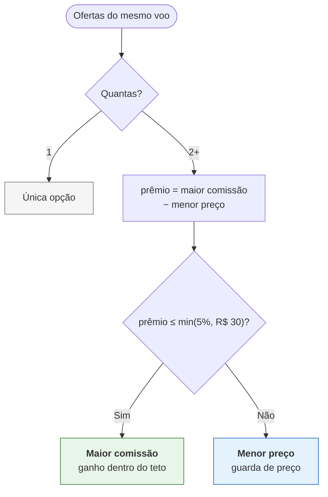

# PassHub — Agregador de Provedores de Voos

Consulta três provedores em paralelo, normaliza, deduplica e decide qual
oferta mostrar, maximizando margem sem prejudicar o cliente.

**Produção:** https://passhub.abel.dev.br
**API:** `POST /search` · `GET /docs` · `GET /dashboard` · `GET /status`
**Traces:** [passhub.abel.dev.br/traces](https://passhub.abel.dev.br/traces) —
um request, 30 spans, do HTTP ao `COMMIT` no Postgres

```bash
docker compose up -d     # providers + api + redis + postgres
npm test                 # 65 testes
```

UI em `/`, API em `:8000`, providers em `3001-3003`.

## Stack

Node 22 · TypeScript · Fastify 5 · Zod · PostgreSQL 17 · Redis · Prometheus ·
OpenTelemetry · Docker · Caddy · Vitest · GitHub Actions.

## Como a busca funciona

```
POST /search
  ├─ valida (Zod) · consulta cache Redis (TTL 300s) → HIT devolve em ms
  ├─ fan-out paralelo aos 3 providers
  │    timeout 3s · retry com backoff · circuit breaker por provider
  ├─ adaptadores → modelo único (centavos→real, ISO→UTC, descarta USD e preço≤0)
  ├─ dedupe por (companhia, partida, chegada) com tabela de aliases
  ├─ seleção por estratégia · ranking (partida → preço → companhia)
  └─ persiste busca e ofertas no Postgres
```

Provider fora não derruba a resposta: devolve os voos dos que responderam com
`meta.partial = true`.

**Prova ao vivo:** abra `/telemetria`. Faça uma busca em `/cotacoes` e volte —
a entrada aparece com o TTL de 300s descendo a cada segundo. Repita a busca e
os acertos sobem, com o header `x-search-cache: HIT`. A mesma tela mostra o
estado dos breakers e a latência por provider, lidos de `/metrics`.

Fora da tela: `./scripts/demo-cache.sh` (MISS vs HIT) e
`./scripts/demo-metrics.sh` (métricas formatadas).

## Estrutura

```
src/
  server.ts · app.ts · container.ts    entrypoint e injeção de dependência
  core/search/                         regra pura: modelo, adaptadores, dedupe, seleção
  adapters/                            cache · db/postgres · http/providers · security · telemetry
  config/                              env validado e tabela de comissões
  http/                                uma pasta por rota
public/   UI estática
tests/    unidade, integração, resiliência e arquitetura
mocks/    os três providers do desafio (intocados)
```

`tests/architecture.test.ts` trava as camadas: `core` não importa `adapters`,
`http` nem `config` e não usa biblioteca de I/O; `adapters` não importa
`http`; nenhum arquivo pode ficar órfão. Furou a regra, o CI falha.

## Regra de negócio: margem com guarda de preço

O mesmo voo chega de vários providers com preço e comissão diferentes. Há
três caminhos possíveis, e a escolha entre eles é o coração do desafio.



### Por que esse critério

O dado que decide: **quanto a casa ganha versus quanto o cliente paga a mais**.

Medido nos mocks, nos 35 voos em que a maior comissão paga mais que a menor:

| | Cliente paga | Casa ganha | Razão |
|---|---|---|---|
| Sempre maior comissão | +R$ 631,81 | +R$ 190,07 | **0,30** |

Em **todos** os 35 voos, o cliente paga mais do que a casa ganha — e em
nenhum a comissão extra cobre o preço extra. Maximizar comissão sem teto
transfere valor do cliente para ninguém: a casa ganha R$ 0,30 por real que o
cliente perde. Quando ele descobre a cotação direta, a venda e o cliente vão
junto.

### Por que 5% / R$ 30

| Teto | Receita | vs. menor preço | Voos bloqueados |
|---|---|---|---|
| menor preço sempre | R$ 668,70 | — | 35 |
| 2% / R$ 20 | R$ 750,23 | +12,2% | 25 |
| 3% / R$ 25 | R$ 837,60 | +25,3% | 4 |
| **5% / R$ 30** | **R$ 858,77** | **+28,4%** | **0** |

O teto de 5% captura **todo** o ganho disponível nestes dados, com prêmio
máximo de 2,7% ao cliente — abaixo de qualquer limiar que o agente perceba
ao fechar a venda. Um teto mais apertado (2%) abre mão de 16 pontos de
receita sem benefício proporcional ao cliente.

Acima de R$ 600 o limite absoluto (R$ 30) é mais restritivo que o percentual;
abaixo, vale o percentual. O `min()` dos dois evita que a regra seja frouxa
em voos caros e rígida em voos baratos.

Com estes dados a guarda nunca dispara — o maior prêmio é 2,7%. Ela é a
salvaguarda para o caso em que a diferença de comissão supere o desconto,
coberto por teste com preços sintéticos. Cada voo devolve `selectionReason`
("maior comissão dentro do teto", "guarda de preço", "única oferta"), então a
decisão é auditável na resposta.

`x-strategy` alterna o critério: `commission_guarded` (padrão), `lowest_price`
e `max_commission`. A aplicada volta em `meta.strategy`.

## Dados

Postgres guarda o evento bruto: `providers` (comissão, uma vez só), `searches`,
`search_offers` (voo × provider, com `chosen`) e `clicks` (FK `search_id`).
Conversão é JOIN — `GET /insights/funnel` lê daí.

Redis guarda o cache de resposta (TTL 5 min) e os contadores horários do
dashboard. Descartável por desenho.

LGPD: o IP nunca é gravado — só `sha256(IP_SALT + ip)` truncado. Sem salt, a
API se recusa a subir em produção.

## Interface


## Deploy

Push no `main` → `ci.yml` (typecheck + 65 testes + build) → `deploy.yml`
sincroniza a EC2, reconstrói, troca o container e valida `/health` e as rotas
públicas. Falhou, a versão anterior continua no ar.

Secrets: `EC2_HOST`, `EC2_USER`, `EC2_SSH_KEY`, `EC2_APP_DIR`. O `.env.prod`
vive só na instância — ver `.env.example`.

## Trade-offs

- **EC2 com Compose, não Lambda.** Cold start de ~1,3 s é falha de UX num
  produto aberto dezenas de vezes por dia; o Compose local é o mesmo de
  produção. Custo: ~US$14/mês de VM sempre ligada. Em escala alta a Lambda
  voltaria a vencer em custo e elasticidade.
- **Um banco, não dois.** O Redis responde agregado, não funil; funil exige
  evento bruto, e evento bruto precisa de armazenamento durável. Um segundo
  banco para o mesmo domínio seria overengineering.
- **Sem feature flag.** Não há decisão de produto que exija rollback em
  minutos. `x-strategy` é parâmetro por chamada, não flag de rollout.
- **Guarda de preço sobre comissão pura.** Abre mão de receita quando o
  prêmio ao cliente passa do teto — a tabela acima mostra que essa renúncia
  é de 0% com os dados atuais e protege a conversão no caso oposto.
- **Chaos opcional.** `docker compose --profile chaos` derruba o provider-c
  em 30% e demonstra a resposta parcial ao vivo.

## Como evoluiria em produção

- Providers reais com mTLS e contrato versionado por adaptador — quando um
  provider muda o payload, só o adaptador dele quebra.
- Invalidação de cache por evento de preço, em vez de esperar o TTL.
- Réplica de leitura para o dashboard e retenção particionada por mês.
- SLO explícito (p99 < 2,5 s, resposta parcial < 1%) com alarme quando o
  breaker abre; trace ligado com collector ADOT.
- A/B entre `commission_guarded` e `lowest_price`, medindo receita ×
  conversão — o funil já fornece a métrica.

Não colocaria fila no caminho síncrono: a latência é o produto.
