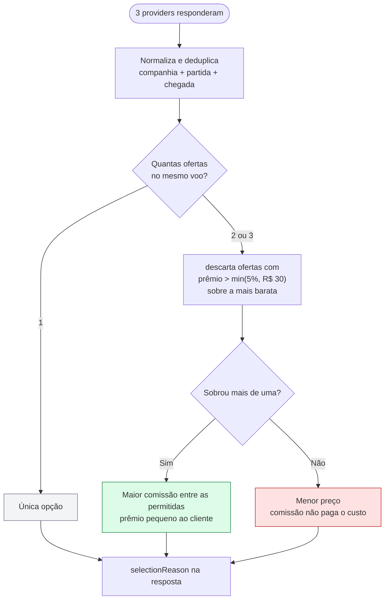
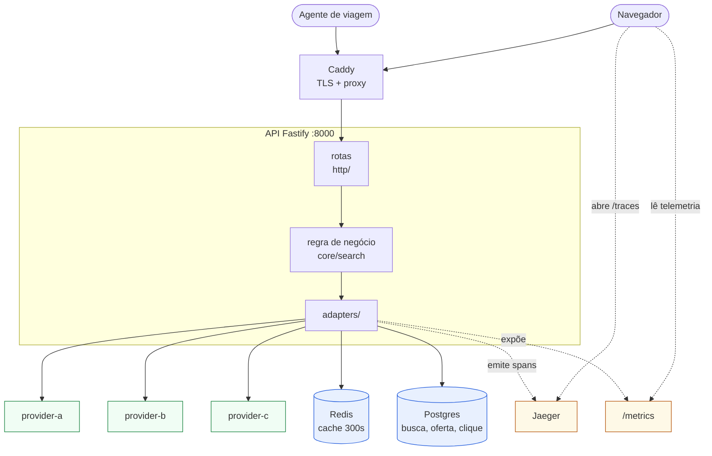
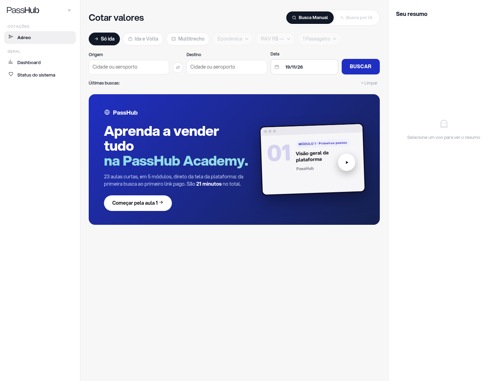
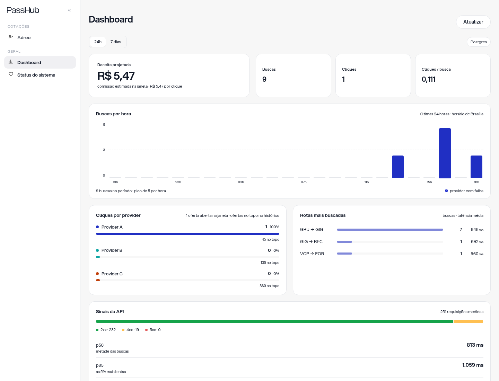
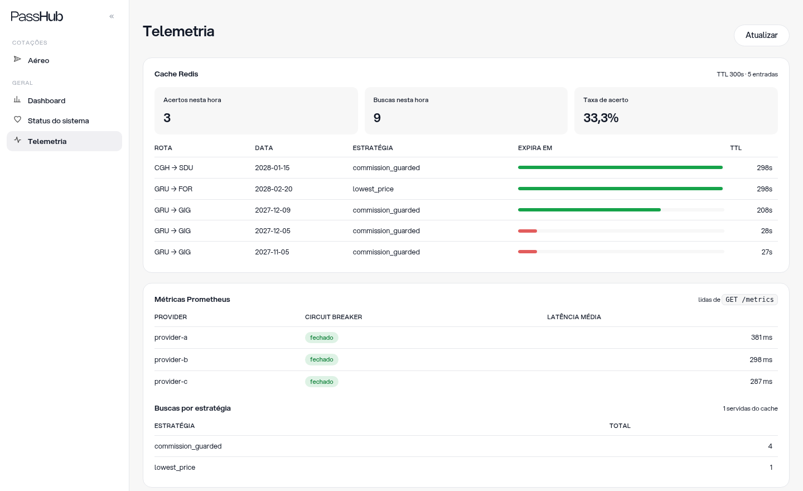
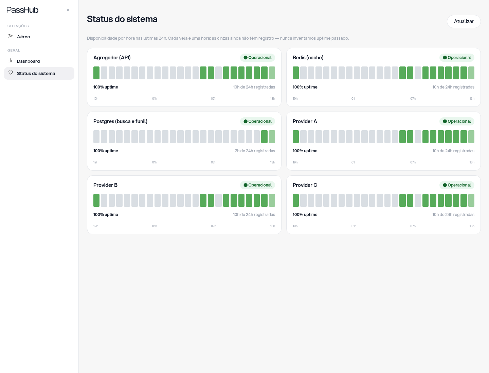

# PassHub: Agregador de Provedores de Voos

Consulta três provedores em paralelo, normaliza, deduplica e decide qual
oferta mostrar, maximizando margem sem prejudicar o cliente.

**Produção:** https://passhub.abel.dev.br
`docker compose up -d` · `npm test` (70 testes)

## Requisitos

| Requisito | Onde está |
|---|---|
| `POST /search` | [Swagger](https://passhub.abel.dev.br/docs) · `src/http/search/` |
| Consultas paralelas | `fan-out.ts`, `Promise.allSettled` |
| Timeout de 3 s por provider | `client.ts`, `TIMEOUT_MS = 3_000` |
| Continua se um provider falhar | `docker compose --profile chaos up` · `tests/resilience.test.ts` |
| Cache Redis TTL 5 min | [telemetria](https://passhub.abel.dev.br/telemetria) com o TTL descendo |
| Normalização | `core/search/adapters/` · `tests/adapters.test.ts` |
| Ordenação consistente | `core/search/ranking.ts` |
| Regra de negócio | `core/search/selection.ts` · [abaixo](#regra-de-negócio) |
| Docker Compose | `docker-compose.yml` |
| Testes | `npm test`, 70 testes em 11 arquivos |

## Bônus

| Item | Onde está |
|---|---|
| Retry exponencial | `client.ts`, backoff 100 ms·2ⁿ com jitter |
| Circuit breaker | `breaker.ts`, 5 falhas abre, 15 s meio-aberto |
| OpenTelemetry | [Jaeger em produção](https://passhub.abel.dev.br/traces/), 30 spans por busca |
| Logs estruturados | Pino, cada busca loga rota, latência e `partial` |
| Prometheus | [`/metrics`](https://passhub.abel.dev.br/metrics) |
| Health Check | [`/health`](https://passhub.abel.dev.br/health) · [`/status`](https://passhub.abel.dev.br/status) |
| GitHub Actions | `ci.yml` e `deploy.yml` |
| Docker multi-stage | `Dockerfile`, build e runtime, usuário não-root |
| Cloud com IP público | https://passhub.abel.dev.br |
| Banco + dashboard | [Dashboard](https://passhub.abel.dev.br/dashboard) · [funil](https://passhub.abel.dev.br/insights/funnel) |
| Melhoria arquitetural | `tests/architecture.test.ts` quebra o CI se as camadas forem violadas |

## Regra de negócio

O mesmo voo chega de vários providers com preço e comissão diferentes.
Escolher sempre a maior comissão maximiza a receita por venda, mas cobrar
mais do que o cliente cotaria direto perde a venda e o cliente.



### Por que esse teto

Medi os 35 voos dos mocks em que a maior comissão paga mais que a menor. Escolhendo
sempre a maior, o cliente paga R$ 631,81 a mais e a casa ganha R$ 190,07.
A razão é 0,30: cada real que o cliente perde vira 30 centavos para a casa.
Em nenhum deles a comissão extra cobre o preço extra.

| Critério | Receita por busca | vs. menor preço |
|---|---|---|
| menor preço sempre | R$ 668,70 | nenhuma |
| 2% ou R$ 20 | R$ 750,23 | +12,2% |
| 3% ou R$ 25 | R$ 837,60 | +25,3% |
| **5% ou R$ 30** | **R$ 858,77** | **+28,4%** |

O teto de 5% captura todo o ganho disponível, e o maior prêmio ao cliente
ficou em 2,7%. Abaixo de R$ 600 vale o percentual, acima vale o limite
absoluto, então a regra não fica frouxa em voo caro.

O teto é um filtro, não um teste binário: primeiro descarto as ofertas que
custariam mais que o teto sobre a mais barata, depois escolho a maior comissão
entre as que sobraram. Assim uma oferta do meio que cabe no teto não é
ignorada só porque outra mais cara estourou o limite.

Com os mocks a guarda nunca descarta nada, porque o prêmio máximo fica em 2,7%.
Ela existe para quando a comissão extra supera o desconto, coberto por
teste com preço sintético. Cada voo traz `selectionReason`, então a decisão
é auditável. Implementei as três candidatas para comparar; a API serve só a
escolhida, e as outras duas ficam como `selectLowestPrice` e
`selectMaxCommission` no teste de comparativo.

## Como a busca funciona

```
POST /search
  valida (Zod), consulta o cache (TTL 300s) e devolve em ~150ms se houver HIT
  senão chama os 3 providers em paralelo, com timeout, retry e breaker
  normaliza, deduplica, aplica a regra e ordena
  grava a busca e as ofertas no Postgres
```

Provider fora não derruba a resposta: o cliente recebe os voos de quem
respondeu e `meta.partial: true`.

## Estrutura

```
src/
  core/search/     regra pura: modelo, adaptadores, dedupe, seleção
  adapters/        cache, postgres, http dos providers, telemetria
  config/          env validado e tabela de comissões
  http/            uma pasta por rota
  server.ts, app.ts, container.ts
public/  UI · tests/  unidade, integração, resiliência, arquitetura · mocks/
```

`tests/architecture.test.ts` garante que `core` não importa `adapters`,
`http` nem `config`, e que nenhum arquivo fica órfão.



A tela de telemetria lê `/metrics` direto no navegador; nenhum Prometheus
faz scrape em produção.

## Dados

Postgres guarda `providers` (a comissão existe uma vez só), `searches`,
`search_offers` (voo por provider, com a flag `chosen`) e `clicks`, que
aponta para a busca por FK. Conversão é JOIN.

Redis guarda o cache de resposta com 5 minutos e os contadores horários.
Perder uma entrada só custa uma busca a mais.

O IP nunca é gravado. Só `sha256(IP_SALT + ip)` truncado, suficiente para
contar agentes distintos. Em produção a API se recusa a subir sem o salt.

## Interface

[](https://passhub.abel.dev.br/)
[](https://passhub.abel.dev.br/dashboard)
[](https://passhub.abel.dev.br/telemetria)
[](https://passhub.abel.dev.br/status)

## Deploy

Push no `main` roda o CI (typecheck, 70 testes e build) e, se passar, o
deploy sincroniza com a EC2, reconstrói a imagem, troca o container e
valida as rotas públicas. Se algo falhar, a versão anterior continua no ar.

Secrets: `EC2_HOST`, `EC2_USER`, `EC2_SSH_KEY`, `EC2_APP_DIR`. O `.env.prod`
vive só na instância, ver `.env.example`.

## Trade-offs

- **EC2 com Compose, não Lambda.** Cold start de 1,3 s é ruim num produto
  aberto dezenas de vezes por dia, e o Compose local é o mesmo de produção.
  Custa cerca de US$ 14 por mês. Em escala alta a Lambda voltaria a ganhar.
- **Um banco, não dois.** O Redis responde agregado, mas não funil. Funil
  precisa de evento bruto, e evento bruto precisa de armazenamento durável.
- **Guarda de preço em vez de comissão pura.** Abre mão de receita quando o
  prêmio ao cliente passa do teto. Com os dados atuais, a renúncia é zero.
- **Jaeger na própria instância.** Custa 9 MB de RAM e não abre porta nova,
  mas a retenção fica em memória, sem histórico longo.

## Como evoluiria

- Providers reais com mTLS e contrato versionado por adaptador.
- Invalidação de cache por evento de preço, em vez de esperar o TTL.
- Réplica de leitura e retenção particionada por mês.
- SLO explícito com alarme quando o breaker abre.
- A/B medindo receita contra conversão no menor preço. As duas funções de
  referência já existem, falta o experimento.

Não colocaria fila no caminho síncrono, porque a latência é o produto.